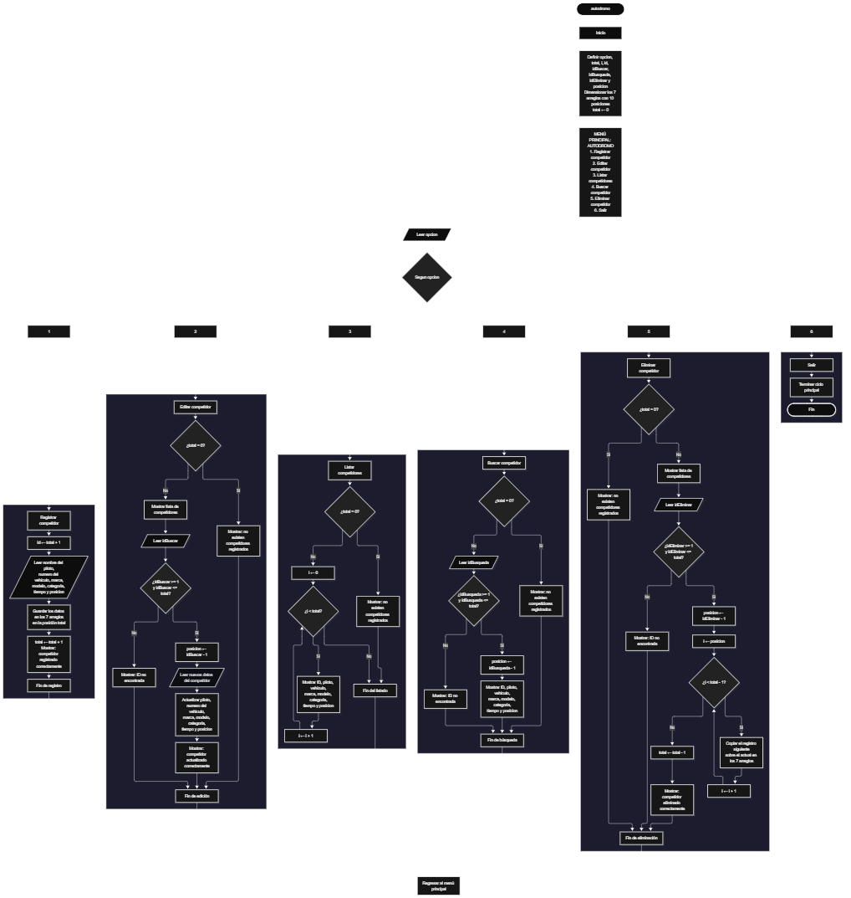

Este proyecto, llamado <b>autodromo</b>, fue desarrollado en <b>Java</b> como un ejercicio práctico para fortalecer la lógica de programación mediante la creación de un sistema de gestión de competidores desde la consola. El programa cuenta con un menú principal de seis opciones que permite <b>registrar, editar, listar, buscar y eliminar competidores</b>. Cada competidor almacena información como el nombre del piloto, el número del vehículo, la marca, el modelo, la categoría de competencia, el tiempo obtenido y la posición alcanzada, utilizando arreglos con una capacidad máxima de <b>10 competidores durante la ejecución</b>. Durante su desarrollo se aplicaron conceptos fundamentales de programación, como variables, arreglos, estructuras condicionales, ciclos repetitivos y estructuras de selección, además de procesos para buscar, modificar, eliminar y organizar registros. Este proyecto permite poner en práctica los conocimientos adquiridos en Java y sirve como base para desarrollar sistemas de gestión más avanzados utilizando otros lenguajes y tecnologías.

<h2 align="center">⚙️ Funcionamiento del menú principal</h2>

### ➕ Registrar competidor

La opción <b>1) registrar competidor</b> permite agregar un nuevo participante al sistema del autódromo. Para comenzar, el programa genera automáticamente un ID utilizando la expresión <b>total + 1</b>, que representa el número correspondiente al nuevo competidor. Después, solicita el <b>nombre del piloto, número del vehículo, marca, modelo, categoría de competencia, tiempo obtenido en minutos y posición alcanzada</b>. Cada dato se almacena en la posición actual de su respectivo arreglo, utilizando la variable <b>total</b> como índice. Finalmente, muestra el mensaje <b>"Competidor registrado correctamente."</b> y aumenta la variable <b>total</b> en uno para actualizar la cantidad de competidores registrados. El programa dispone de 10 posiciones por arreglo, pero actualmente no incluye una validación que impida superar esa capacidad.

### ✏️ Editar competidor

La opción <b>2) editar competidor</b> permite modificar la información de un participante registrado. Primero, el programa comprueba si existen competidores almacenados mediante la variable <b>total</b>. Si no hay registros, muestra el mensaje <b>"No existen competidores registrados."</b>. En caso contrario, presenta una lista con el ID, nombre del piloto, número del vehículo, marca, modelo, categoría, tiempo y posición de cada competidor. Después, solicita el ID del participante que se desea editar y comprueba que esté dentro del rango permitido mediante la condición <b>idBuscar &gt;= 1 y idBuscar &lt;= total</b>. Si la selección es válida, calcula la posición correspondiente utilizando <b>posicion = idBuscar - 1</b> y solicita los nuevos datos del competidor. La información se actualiza directamente en los siete arreglos correspondientes. Finalmente, muestra el mensaje <b>"Competidor actualizado correctamente."</b>. Si el ID introducido no corresponde a un competidor registrado, presenta el mensaje <b>"ID no encontrada."</b>.

### 🗑️ Eliminar competidor

La opción <b>5) eliminar competidor</b> permite eliminar un participante registrado mediante su ID. Antes de comenzar, el programa comprueba que existan competidores almacenados. Si no hay registros, muestra el mensaje <b>"No existen competidores registrados."</b>. Si hay competidores disponibles, presenta una lista con sus respectivos datos para facilitar la selección. Después, solicita el ID del competidor que se desea eliminar y verifica que se encuentre dentro del rango válido. Si el ID existe, calcula su posición mediante <b>posicion = idEliminar - 1</b> y comienza el proceso de eliminación. Para mantener los registros organizados, utiliza un ciclo <b>for</b> controlado por la variable <b>i</b>, que desplaza una posición hacia la izquierda los datos de los competidores posteriores en los siete arreglos: <b>pilotos, numerosVehiculo, marcas, modelos, categorias, tiempos y posiciones</b>. Posteriormente, disminuye la variable <b>total</b> en uno y muestra el mensaje <b>"Competidor eliminado correctamente."</b>. Si el ID seleccionado no corresponde a un competidor registrado, informa mediante el mensaje <b>"ID no encontrada."</b>.

### 🔎 Buscar competidor

La opción <b>4) buscar competidor</b> permite localizar un participante mediante su ID. Primero, el programa comprueba si existen competidores registrados. Si no hay información almacenada, muestra el mensaje <b>"No existen competidores registrados."</b>. En caso contrario, solicita el ID del competidor que se desea buscar y comprueba que esté dentro del rango permitido mediante la condición <b>idBusqueda &gt;= 1 y idBusqueda &lt;= total</b>. Si el ID es válido, calcula la posición correspondiente utilizando <b>posicion = idBusqueda - 1</b> y muestra los datos completos del participante encontrado: <b>nombre del piloto, número del vehículo, marca, modelo, categoría, tiempo obtenido y posición alcanzada</b>. Si el ID introducido no corresponde a ningún competidor registrado, presenta el mensaje <b>"ID no encontrada."</b>. La búsqueda se realiza mediante el número de identificación asignado según la posición del registro.

### 📋 Listar competidores

La opción <b>3) listar competidores</b> permite visualizar todos los participantes registrados actualmente en el sistema. Antes de mostrar la información, el programa comprueba si la variable <b>total</b> es igual a cero. Si no existen competidores registrados, presenta el mensaje <b>"No existen competidores registrados."</b>. Si hay participantes disponibles, utiliza un ciclo <b>for</b> para recorrer los arreglos desde la primera posición hasta el número total de competidores registrados. Durante el recorrido, muestra el ID, nombre del piloto, número del vehículo, marca, modelo, categoría, tiempo obtenido en minutos y posición alcanzada de cada participante. Esta función facilita consultar los registros existentes sin necesidad de buscar cada competidor individualmente.

### 🚪 Salir del menú principal

La opción <b>6) salir</b> está destinada a finalizar la ejecución del programa y muestra el mensaje <b>"Gracias por utilizar Autodromo."</b>. El menú principal se encuentra dentro de una estructura repetitiva <b>do ... while</b>, que mantiene el programa en funcionamiento mientras el usuario realiza las operaciones disponibles. Cuando se selecciona la opción <b>6</b>, la condición <b>opcion != 6</b> deja de cumplirse y el ciclo termina. Finalmente, se ejecuta <b>entrada.close()</b> para cerrar el objeto Scanner utilizado para recibir los datos introducidos por el usuario.

<h2 align="center">🧠 Temas aplicados en el proyecto</h2>

### 📦 Variables

En este proyecto se utilizan variables para almacenar la opción seleccionada en el menú, controlar la cantidad de competidores registrados, recorrer los arreglos, generar los ID, identificar los participantes que se desean editar, buscar o eliminar y determinar la posición correspondiente dentro de los arreglos. Cada variable cumple una función específica dentro de las operaciones de gestión de competidores.

🔢 **Opcion:** Almacena la opción seleccionada por el usuario en el menú principal.

📊 **Total:** Almacena la cantidad actual de competidores registrados.

🔄 **I:** Funciona como contador en los ciclos <b>for</b> y permite recorrer los arreglos, mostrar los registros y desplazar los datos durante la eliminación.

🆔 **Id:** Almacena temporalmente el ID generado para el nuevo competidor mediante la expresión <b>total + 1</b>.

🔎 **IdBuscar:** Almacena el ID introducido por el usuario para seleccionar el competidor que desea editar.

🔍 **IdBusqueda:** Almacena el ID introducido por el usuario para buscar un competidor.

🗑️ **IdEliminar:** Almacena el ID introducido por el usuario para seleccionar el competidor que desea eliminar.

📍 **Posicion:** Almacena el índice correspondiente al competidor seleccionado, calculado mediante la resta de uno al ID introducido.

### 🗃️ Arreglos

En este proyecto se utilizan siete arreglos relacionados con la información de cada competidor. Cada arreglo tiene una capacidad de <b>10 posiciones</b> y utiliza el mismo índice para representar los datos correspondientes a un mismo participante. Por ejemplo, la información de un competidor almacenado en la posición <b>0</b> se encuentra distribuida entre <b>pilotos[0], numerosVehiculo[0], marcas[0], modelos[0], categorias[0], tiempos[0] y posiciones[0]</b>. Esta organización permite recorrer, buscar, modificar, mostrar y eliminar los registros de manera ordenada.

🏎️ **Pilotos[10]:** Almacena los nombres de los pilotos participantes.

🔢 **NumerosVehiculo[10]:** Almacena los números o códigos de los vehículos.

🏭 **Marcas[10]:** Almacena las marcas de los vehículos registrados.

🚘 **Modelos[10]:** Almacena los modelos de los vehículos.

🏁 **Categorias[10]:** Almacena las categorías en las que compiten los participantes.

⏱️ **Tiempos[10]:** Almacena los tiempos obtenidos por los competidores en minutos, utilizando el tipo de dato <b>double</b>.

🏆 **Posiciones[10]:** Almacena las posiciones alcanzadas por los competidores durante la competencia.

### 🔀 Estructuras condicionales

En este proyecto se utilizan las estructuras <b>if</b> y <b>else</b> para comprobar si existen competidores registrados antes de realizar determinadas operaciones, validar que el ID seleccionado se encuentre dentro del rango permitido y determinar si el usuario ha introducido un identificador válido. Estas condiciones permiten que el programa responda de manera diferente según la cantidad de registros almacenados y el resultado de cada operación.

### 🔄 Estructuras repetitivas

En este proyecto se utilizan los ciclos <b>for</b> y <b>do ... while</b>. Los ciclos <b>for</b> permiten recorrer los arreglos para mostrar los competidores registrados y presentar sus datos durante las operaciones de edición y eliminación. También se utilizan para desplazar los datos de los competidores posteriores una posición hacia la izquierda cuando se elimina un registro. Por otro lado, el ciclo <b>do ... while</b> mantiene activo el menú principal para que el usuario pueda ejecutar diferentes operaciones antes de salir del programa.

### 🎯 Estructura según

El programa evalúa el valor almacenado en la variable <b>opcion</b> mediante la estructura <b>switch</b> y ejecuta el bloque de instrucciones correspondiente. Cada caso representa una operación específica del sistema: <b>registrar, editar, listar, buscar, eliminar o salir</b>. También se utiliza el bloque <b>default</b> para mostrar el mensaje <b>"Opcion no valida."</b> cuando el usuario introduce un número que no coincide con ninguna de las opciones definidas en el menú.

### 🔢 Dimensionamiento de arreglos

En este proyecto se utilizan arreglos declarados directamente en Java con una capacidad de <b>10 posiciones</b>. Cada uno se inicializa mediante la instrucción <b>new</b>, estableciendo su tamaño y tipo de dato correspondiente. Se definieron siete arreglos para almacenar la información de los competidores, mientras que la variable <b>total</b> controla la cantidad de posiciones ocupadas durante la ejecución. De esta manera, las operaciones recorren únicamente los registros comprendidos entre la primera posición y el total actual de competidores.

### 🔄 Reorganización de registros

Cuando se selecciona un competidor para eliminarlo, el programa utiliza un ciclo <b>for</b> que comienza en la posición seleccionada y continúa hasta <b>total - 1</b>. En cada repetición, los datos de la posición siguiente se copian sobre la posición actual en los siete arreglos: <b>pilotos, numerosVehiculo, marcas, modelos, categorias, tiempos y posiciones</b>. Después, la variable <b>total</b> disminuye en uno para actualizar la cantidad de competidores registrados. De esta manera, los registros posteriores ocupan las posiciones disponibles sin dejar espacios vacíos entre los registros activos. La última posición no se limpia explícitamente, ya que deja de formar parte de los registros considerados por el programa.

<h2 align="center">¿Cómo se implementaron las operaciones crud en el proyecto?</h2>

Las operaciones <b>CRUD</b> se implementaron mediante las opciones del menú principal, permitiendo administrar los competidores registrados. La operación <b>crear</b> corresponde a <b>registrar competidor</b>, donde se introducen los datos de un nuevo participante; <b>leer</b> se realiza mediante las opciones <b>buscar competidor y listar competidores</b>; <b>actualizar</b> corresponde a <b>editar competidor</b>, donde se modifican los datos de un participante registrado; y <b>eliminar</b> se realiza mediante la opción <b>eliminar competidor</b>. Estas operaciones utilizan variables, arreglos, condicionales y ciclos para gestionar la información almacenada temporalmente durante la ejecución del programa.

<h2 align="center">Diagrama de flujo del proyecto</h2>

<h2 align="center">🛡️ Validaciones del programa</h2>

### 📭 No existen competidores registrados

Esta validación se utiliza en las opciones de <b>editar, listar, buscar y eliminar competidores</b>. El programa comprueba si la variable <b>total</b> es igual a <b>0</b> y, si no existen participantes registrados, muestra el mensaje <b>"No existen competidores registrados."</b>. Esta comprobación evita continuar con las operaciones que necesitan información almacenada cuando no hay competidores disponibles.

### 🔢 Selección de competidores

El programa utiliza las variables <b>idBuscar, idBusqueda e idEliminar</b> para identificar al competidor que se desea editar, buscar o eliminar. Antes de realizar estas operaciones, comprueba que el ID introducido sea mayor o igual a <b>1</b> y menor o igual al valor de <b>total</b>. Si la selección está dentro de ese rango, calcula la posición correspondiente restando uno al ID. Si el número introducido no corresponde a un competidor registrado, muestra el mensaje <b>"ID no encontrada."</b>. Esta validación evita modificar, buscar o eliminar posiciones que no corresponden a registros activos.

### ⚠️ Capacidad máxima de los arreglos

Los siete arreglos utilizados en el proyecto tienen una capacidad fija de <b>10 posiciones</b>. Sin embargo, el programa actual no incluye una condición que compruebe si se ha alcanzado esa capacidad antes de registrar un nuevo competidor. Por este motivo, si se intenta agregar un registro cuando ya existen 10 competidores, se puede producir una excepción <b>ArrayIndexOutOfBoundsException</b>, debido a que se intentaría acceder a una posición fuera de los límites del arreglo.

### ⚠️ Datos de tiempo y posición

Durante el registro y la edición, el programa solicita el tiempo obtenido en minutos y la posición alcanzada por cada competidor. El tiempo se almacena mediante el tipo de dato <b>double</b> y la posición mediante el tipo <b>int</b>. Sin embargo, el código actual no incluye condiciones que comprueben que estos valores sean positivos o que correspondan a resultados válidos de una competencia. Por lo tanto, el sistema almacena los valores introducidos siempre que sean compatibles con los tipos de datos solicitados.

### ⚠️ Opción inválida

La estructura <b>switch</b> incluye el bloque <b>default</b>, que muestra el mensaje <b>"Opcion no valida."</b> cuando el usuario introduce un número que no corresponde a ninguna de las opciones definidas en el menú. Esta alternativa permite informar al usuario cuando selecciona una opción que no está disponible.

<h2 align="center">🎯 Objetivo del proyecto</h2>

El objetivo principal de este proyecto es fortalecer la <b>lógica de programación</b> mediante el desarrollo de un sistema de gestión de competidores de un autódromo en <b>Java</b>. A través de su construcción se busca aplicar los conocimientos adquiridos sobre variables, arreglos, estructuras condicionales, ciclos repetitivos y estructuras de selección, integrándolos para resolver un problema de manera organizada. Además, el proyecto permite comprender cómo registrar, consultar, modificar y eliminar información en una aplicación de consola, estableciendo una base para desarrollar sistemas de gestión más completos con otros lenguajes y tecnologías.

